<p align="center">
  <a href="https://www.afaris.me">
    
  </a>
</p>

<p align="center">
  <a href="https://www.afaris.me">
    
  </a>
</p>

<p align="center">
  <a href="https://www.afaris.me"></a>
  <a href="https://linkedin.com/in/ahmedfaris"></a>
  <a href="https://adplist.org/mentors/ahmed-faris"></a>
  <a href="https://dribbble.com/alfaris"></a>
  <a href="https://www.behance.net/alfaris"></a>
  <a href="https://www.figma.com/@alfaris"></a>
  <a href="https://www.youtube.com/@afarisws"></a>
</p>

<p align="center">
  
  
  
</p>

---

## 👋 Hey, I'm Faris

```js
const faris = {
  role:      "Sr. Product Designer @ Teracloud",
  since:     2000,                       // designing & building for the web
  craft:     ["Complex products", "Design systems", "Engineering collaboration", "AI prototyping"],
  teaching:  { learners: "10,000+", udemyRating: 4.8, adplistSessions: 87 },
  shipping:  "6 products built with AI — and counting",
  motto:     "Design is how it works for the 100-millionth user, too.",
};
```

## 📈 Impact, in numbers

<table align="center">
  <tr>
    <td align="center" width="33%"><h1>15+</h1><sub>years designing products</sub></td>
    <td align="center" width="33%"><h1>100M+</h1><sub>Egyptians served by <b>Digital Egypt</b></sub></td>
    <td align="center" width="33%"><h1>10K+</h1><sub>learners taught · ⭐ 4.8 on Udemy</sub></td>
  </tr>
</table>

## 🧰 What I do

| 🔍 UX Strategy & Audit | 🎨 Product Design | 🎓 Training & Mentorship |
|:--|:--|:--|
| UX audits · Strategy · Research | Websites · Mobile apps · eCommerce · SaaS & dashboards | Online courses · Team trainings · 1:1 mentoring |

## ⚡ Shipped with AI

> Designers who build. These are live products I designed **and** shipped using AI-assisted workflows.

<p align="center">
  <a href="https://wndrai.space"></a>
  <a href="https://batota.net"></a>
  <a href="https://vthesis.com"></a><br/>
  <a href="https://cairowalks.vercel.app"></a>
  <a href="https://getwealthlens.com"></a>
  <a href="https://www.almejarra.com"></a>
</p>

## 🚀 Ventures

- 🌠 **[Al Mejarra المجرة](https://www.almejarra.com)** — Founder & Co-owner · coworking space in Zagazig · *2014 → now*
- ✈️ **[Travel Buddies بالعربي](https://www.tba.eg)** — Co-founder & Managing Partner · *2020 → now*
- 🧠 **[XPR Community خِبِر](https://www.xprcommunity.com)** — Founder & Instructor · *2026 → now*

## 🤝 Trusted by

<p align="center">
  <sub>
  Digital Egypt · Magalix · Nile University · MedxJordan · Eduwave · Starwallet Labs · ITS ·
  Tamkeen Technologies · QualiTech Egypt · Saudi Ministry of Human Resources
  </sub>
</p>

<p align="center">
  <a href="https://app.uxcel.com/certificates/D9KHID2UQ7HC">
    
  </a>
</p>

## 🌙 Off the clock

<table align="center">
  <tr>
    <td align="center" width="33%">🔭<br/><b>Stargazing</b><br/><sub>Astronomy nerd: happiest under a dark sky</sub></td>
    <td align="center" width="33%">🐎<br/><b>Equestrian</b><br/><sub>Horses, the original user-centred design</sub></td>
    <td align="center" width="33%">🌱<br/><b>Always learning</b><br/><sub>Design Ops · Python · Data analysis</sub></td>
  </tr>
</table>

## 📊 On GitHub

<p align="center">
  
</p>

---

<p align="center">
  <b>Got a complex product problem — or want a mentor who's been there?</b><br/>
  <a href="https://adplist.org/mentors/ahmed-faris">Book a free mentoring session</a> ·
  <a href="https://www.afaris.me/#contact">Say hello</a> ·
  <a href="https://www.afaris.me/case-studies/">See case studies</a>
</p>

<p align="center">
  
</p>
